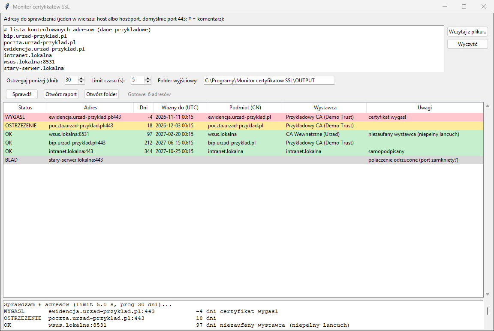

# Monitor certyfikatów SSL

Program dla administratora IT. Dla **listy adresów** (BIP, poczta, serwery
wewnętrzne, urządzenia z interfejsem WWW) sprawdza daty ważności certyfikatów
SSL/TLS i pokazuje, **które wygasają** — zanim użytkownicy zobaczą w przeglądarce
ostrzeżenie. Wynik jest w oknie i w **raporcie Excela**.

Program tylko **łączy się z podanymi adresami** (zwykłe uzgodnienie TLS, tak jak
przeglądarka). Niczego tam nie zmienia i nie wysyła żadnych danych.



*(na zrzucie dane fikcyjne)*

## Szybki start

1. Zainstaluj [Pythona](https://www.python.org/downloads/windows/) 3.11 lub nowszego
   (zaznacz **„Add python.exe to PATH”** i **„tcl/tk and IDLE”**).
2. Pobierz repozytorium (**Code → Download ZIP**) i rozpakuj, np. do `C:\Programy\`.
3. Uruchom **`install.bat`** (raz). Na końcu musi pojawić się „selftest OK”.
4. Uruchom **`uruchom.bat`**, wpisz lub wklej adresy i kliknij **Sprawdź**.

## Adresy

Jeden w wierszu: `host` albo `host:port` (domyślnie port **443**). Rozumie też
`https://host:8443/ścieżka`, adresy IP, IPv6 w nawiasach (`[::1]:443`) i domeny
z polskimi znakami. Puste wiersze, powtórzenia i wiersze zaczynające się od `#`
są pomijane.

Adresy można wkleić w oknie, wczytać przyciskiem **Wczytaj z pliku…** albo
położyć w folderze **`INPUT/`** (pliki `.txt` i `.csv`; w CSV adres jest w pierwszej
kolumnie, separator `;` lub `,`, nagłówek jest pomijany). Zawartość `INPUT/` pojawia się
w polu przy starcie programu. Przykład: [`przyklad/adresy.txt`](przyklad/adresy.txt).

## Wynik

Dla każdego adresu: **podmiot (CN)**, **wystawca**, **ważny od / do**, **dni do wygaśnięcia**,
**nazwy alternatywne (SAN)** i **status**:

| Status | Znaczenie |
|--------|-----------|
| **OK** | ważny co najmniej tyle dni, ile wynosi próg |
| **OSTRZEZENIE** | wygasa za mniej niż próg (domyślnie **30 dni**, do zmiany w oknie / `--prog`) |
| **WYGASL** | termin ważności już minął |
| **BLAD** | nie udało się odczytać certyfikatu (port zamknięty, brak nazwy hosta, brak odpowiedzi w limicie czasu, błąd TLS, zły adres) — powód w kolumnie *Uwagi* |

Certyfikat samopodpisany, od niezaufanego wystawcy albo z niezgodną nazwą **jest
nadal odczytywany** (daty i dane), a problem opisuje kolumna **Uwagi** (np. „samopodpisany”,
„niezgodna nazwa”). Status zależy tylko od dat.

Raport **`OUTPUT/certyfikaty_RRRR-MM-DD_GGMMSS.xlsx`**: arkusz *Certyfikaty* (posortowany od
najbliższego wygaśnięcia, statusy pokolorowane, filtr) i arkusz *Podsumowanie* (liczby wg
statusu, najbliższe wygaśnięcie). Czasy w raporcie są w UTC.

## Uruchomienie z wiersza poleceń

```bash
python monitor_ssl.py                              # okno
python monitor_ssl.py INPUT                        # wsadowo: folder (albo plik) z listami, raport w OUTPUT/
python monitor_ssl.py adresy.csv --prog 14 --timeout 8 --out C:\raporty
python monitor_ssl.py --bez-okna                   # wsadowo na INPUT/ (np. zadanie harmonogramu)
```

Równolegle sprawdzanych jest do 16 adresów, więc lista kilkuset serwerów trwa
zwykle kilkanaście sekund (najwięcej czasu zajmują adresy, które nie odpowiadają
— każdy do limitu czasu, domyślnie 5 s).

## Jak to działa i ograniczenia

- Połączenie i pobranie certyfikatu: biblioteka standardowa Pythona (`ssl`, `socket`).
  Najpierw połączenie z pełną weryfikacją (zaufanie systemu Windows, nazwa hosta); gdy się nie
  uda z powodu certyfikatu, **drugie połączenie bez weryfikacji** tylko po to, by odczytać daty.
- Pola certyfikatu dekoduje **asn1crypto** (czysty Python, mała biblioteka): `ssl` nie umie
  zdekodować certyfikatu, którego nie zweryfikował.
- Sprawdzany jest **certyfikat serwera**, nie cały łańcuch; daty certyfikatów pośrednich nie są
  kontrolowane. Starsze serwery tylko z TLS 1.0/1.1 zgłoszą błąd TLS.
- Serwery z SNI (wiele witryn pod jednym IP) odpowiadają właściwym certyfikatem tylko przy podaniu **nazwy**,
  nie adresu IP.
- Biblioteka `cryptography` jest potrzebna **tylko** testom (selftest generuje certyfikaty
  testowe i uruchamia lokalny serwer TLS na `127.0.0.1`); bez niej selftest pomija ten fragment.
  W GitHub Actions jest instalowana.

## Aktualizacje

Po uruchomieniu program sprawdza w tle na GitHubie, czy jest nowa wersja (moduł `aktualizacja.py`),
i pyta, czy ją pobrać. `INPUT`, `OUTPUT` i `przyklad` nie są nadpisywane. Wyłączenie: pusty plik
`NIE_AKTUALIZUJ` w folderze programu.

## Test

```bash
python monitor_ssl.py --selftest         # logika + serwer TLS na 127.0.0.1, bez internetu
python monitor_ssl.py --selftest --gui   # dodatkowo otwiera okno na chwilę
```
